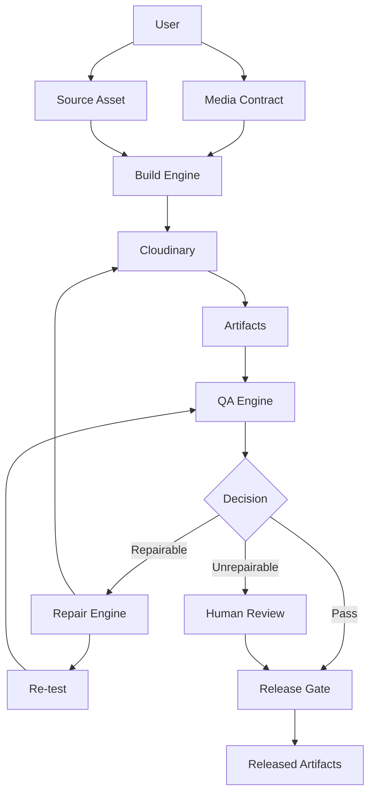
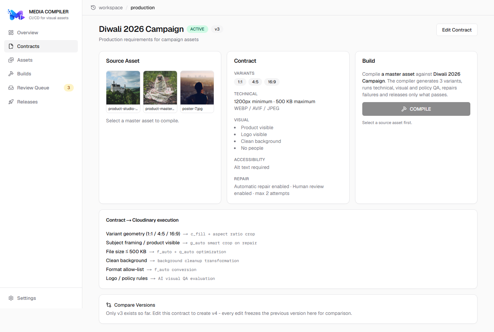
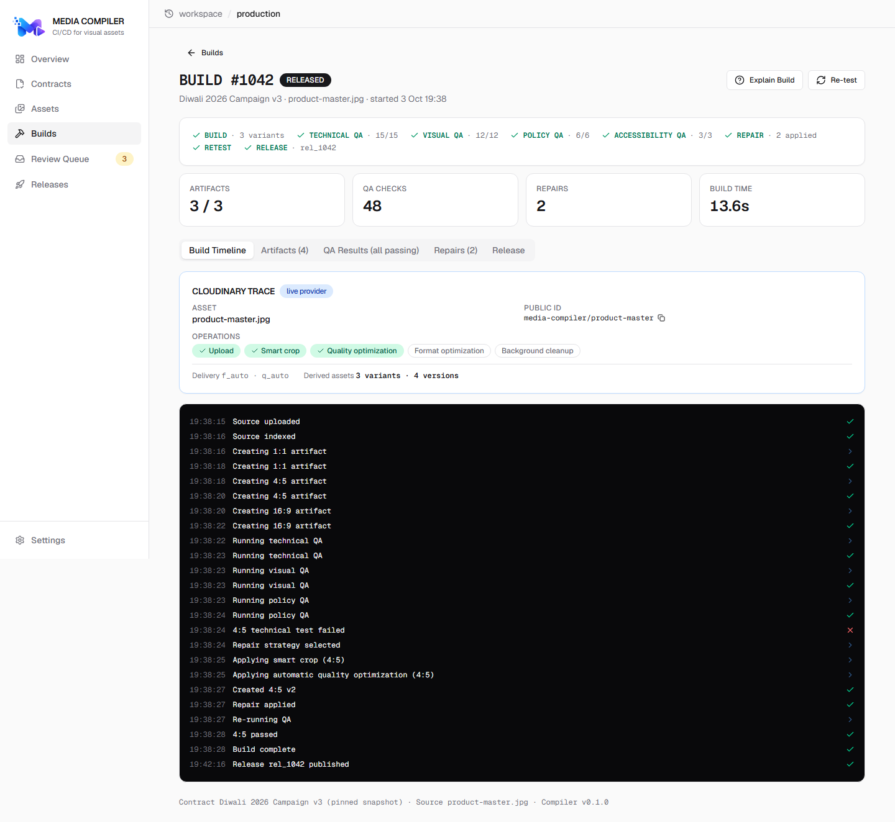
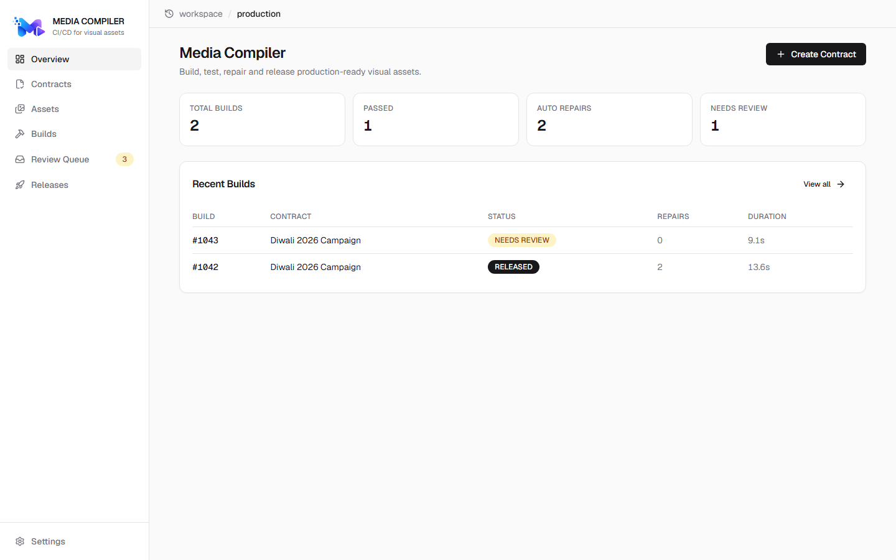
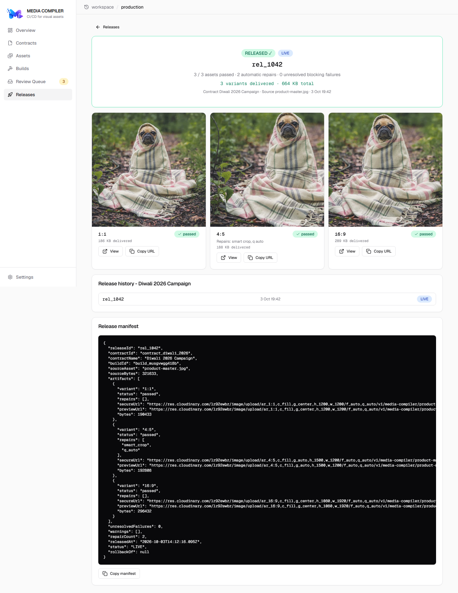
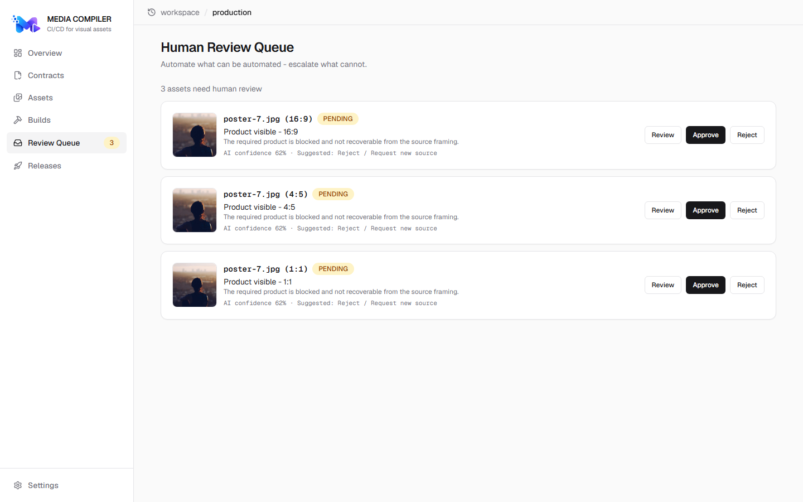

# Media Compiler

<p align="center">
  
</p>

<p align="center">
  <a href="https://hackindia.org/2026/pixels-to-products-cloudinary-ai-hackathon-2026"></a>
  
  
  
</p>

> **Topics:** `cloudinary` `hackathon` `nextjs` `ci-cd` `media-processing` `quality-assurance` `typescript` `tailwindcss` `devtools`

## CI/CD for Visual Assets

**Build. Test. Repair. Release.**

Media Compiler treats visual media like software artifacts. Teams define executable Media Contracts, compile source assets into production variants, run QA, repair safe failures, re-test, and release only verified artifacts.

<!-- Demo video (2-4 min): record the Demo Flow below and link it here. -->

## How It Works

1. Define a versioned **Media Contract** (variants, technical/visual/policy/accessibility rules, severity, repair budget), or start from a preset.
2. Upload a master asset (Cloudinary Upload Widget, direct file upload, or URL).
3. Click **Compile**. Variants generate on Cloudinary; QA streams into a live build log.
4. Failures explain themselves with measured actuals. **Auto Repair** re-derives the artifact and re-tests the full suite.
5. Unrepairable cases go to **human review** with confidence shown.
6. **Release** publishes Cloudinary delivery URLs plus a stored manifest. Compare versions, check regressions, roll back when needed.

## Why Cloudinary?

Cloudinary is the media execution layer. Media Compiler is the lifecycle layer on top.

| Capability | Use | Status |
|---|---|---|
| Upload | Widget + signed API ingestion | Done |
| Transformations | Variant builds, smart-crop + `q_auto`/`f_auto` repairs | Done |
| Metadata | Contract/build/release context on assets | Done |
| Delivery | Released artifact URLs | Done |
| AI visual analysis | Evaluation framework ready | Roadmap |

## Architecture



Thin route handlers; all logic in `src/lib/`. Only `cloudinary.ts` knows SDK details. Release gate enforced server-side (409 on violation).

## Demo

**Live:** [https://media-compiler.onrender.com](https://media-compiler.onrender.com)

**3-minute take:** contract → upload master → Compile → live log → open the 4:5 failure → why → Auto Repair → re-test → Release → Trace → live URL. Then `poster-7.jpg` for the review branch.

**30-second judge check:** failed build → Release tab → RELEASE (server refuses 409) · build Timeline → Cloudinary Trace (real public IDs) · edit contract → Compare Versions.

## Screenshots

| Contract | Build detail |
|---|---|
|  |  |

| Dashboard | Release | Review queue |
|---|---|---|
|  |  |  |

## End-to-End Example

Measured values from a verified run (Diwali Campaign v3, 500 KB limit):

```text
1:1  pass (190 KB)
4:5  fail (product cropped, 1.3 MB measured) → smart crop + q_auto → v2 pass (193 KB)
16:9 pass (296 KB)
Release: 3/3 passed, 0 unresolved blocking failures
```

## Implementation Status

Contracts (versioned, diff) · builds · measured technical QA · visual/policy/accessibility QA · severity + confidence review · bounded repair with explicit rejection · full re-test · regression gate · lineage v1 to v2 · release gate + history + rollback · Trace · review queue · Explain Build · CLI + GitHub Action. Roadmap: AI providers, video, batch, webhooks.

## Quick Start

```bash
git clone https://github.com/zlynv/Media-Compiler.git
cd Media-Compiler
npm install
cp .env.example .env.local
npm run dev
```

Open [http://localhost:3000](http://localhost:3000). Set Cloudinary keys in `.env.local` (see `.env.example`). Seeds load automatically.

## Environment Variables

| Variable | Client? |
|---|---|
| `CLOUDINARY_CLOUD_NAME`, `CLOUDINARY_API_KEY`, `CLOUDINARY_API_SECRET` | No, server only |
| `NEXT_PUBLIC_CLOUDINARY_CLOUD_NAME`, `NEXT_PUBLIC_CLOUDINARY_UPLOAD_PRESET` | Yes |

## Testing

```bash
npm test        # 31 passing
npm run build   # clean
npm run lint    # clean
```

## Limitations

Image-first MVP. Visual verdicts are deterministic contract evaluation (AI provider wiring is roadmap). File-backed store suits demo scale; Postgres is the documented next step. No compliance claims.

## Deploy

No `vercel.json` needed; default Node runtime. On serverless, builds run in-process and the JSON store is instance-local (seeds reload, so demos start identical). For guaranteed live builds use any stateful host with `npm run build && npm start`.

## License

To be added on public release.
